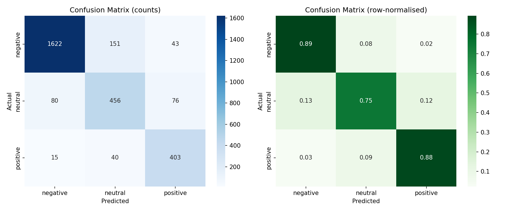

# Multi-Class Sentiment Classifier for Airline Tweets

An NLP project that classifies tweets as **negative**, **neutral** or **positive**. Three approaches are built and compared, from a classic TF-IDF baseline to a fine-tuned transformer.

> Built as Task 2 of an AI internship. Author: **Fiza Asghar**

## Results

All models were evaluated on a held-out, stratified 20% test set (about 2,880 tweets).

| Version | Approach | Accuracy | Macro F1 |
|---|---|---|---|
| v1 | TF-IDF (word 1-2 grams) + Logistic Regression | 77.2% | 0.725 |
| v2 | TF-IDF (word + char n-grams) + tuned Linear SVM, negation handling | 82.0% | 0.770 |
| v3 | Fine-tuned RoBERTa (`twitter-roberta-base-sentiment-latest`) | **86.0%** | **0.822** |

Per-class F1 on the test set:

| Class | v1 | v2 | v3 |
|---|---|---|---|
| Negative | 0.850 | 0.887 | 0.918 |
| Neutral | 0.600 | 0.662 | 0.724 |
| Positive | 0.724 | 0.760 | 0.822 |

Macro F1 (the unweighted mean of the per-class F1 scores) is the main metric because the dataset is imbalanced.



The full write-up (methodology, analysis, limitations) is in [`report/Task2_Report.pdf`](report/Task2_Report.pdf).

## Dataset

[Twitter US Airline Sentiment](https://www.kaggle.com/datasets/crowdflower/twitter-airline-sentiment) (Kaggle). After dropping missing values and duplicate tweets, 14,427 tweets remain:

| Class | Tweets |
|---|---|
| Negative | 9,080 |
| Neutral | 3,057 |
| Positive | 2,290 |

The dataset file is **not included** in this repository. Download `Tweets.csv` from Kaggle and place it in this folder (next to `requirements.txt`).

## Approach

**v1 and v2 (classic ML)**
- Preprocessing: lowercasing, removal of URLs, mentions, punctuation and numbers, stop-word removal (negation words kept), WordNet lemmatization.
- v2 adds contraction expansion and negation handling (`not good` becomes `not_good`).
- Features: TF-IDF. v2 combines word n-grams with character n-grams.
- Models: Logistic Regression and Linear SVM with balanced class weights. v2 tunes them with 3-fold `GridSearchCV` optimised for Macro F1.

**v3 (transformer)**
- Fine-tunes `cardiffnlp/twitter-roberta-base-sentiment-latest` with PyTorch and Hugging Face Transformers on a free Colab T4 GPU.
- Light cleaning only (URLs and mentions normalised). Stop-word removal and lemmatization are not used, because transformers need the full sentence to interpret context and negation.
- Class-weighted cross-entropy loss, AdamW, linear warm-up, mixed precision, best epoch chosen on a validation split.

## Project structure

```
task2-sentiment-classifier/
├── README.md
├── requirements.txt
├── src/
│   ├── sentiment_classifier_v1.py     # TF-IDF + Logistic Regression / SVM
│   └── sentiment_classifier_v2.py     # improved features, negation handling, grid search
├── notebooks/
│   └── task2_bert_colab.ipynb         # transformer fine-tuning (run on Google Colab)
├── results/
│   ├── confusion_matrix.png
│   ├── confusion_matrix_v2.png
│   ├── confusion_matrix_bert.png
│   └── misclassified_examples.csv
└── report/
    └── Task2_Report.pdf
```

## How to run

**v1 and v2 (local)**

```bash
pip install -r requirements.txt

# place Tweets.csv in this folder, then run from this folder:
python src/sentiment_classifier_v1.py
python src/sentiment_classifier_v2.py
```

NLTK data (stop-words, WordNet) is downloaded automatically on the first run. Output files (confusion matrix images, misclassified examples, saved model) are written to the folder you run the script from; the copies in `results/` are the ones from the final runs.

**v3 (Google Colab)**

1. Open [Google Colab](https://colab.research.google.com) and upload `notebooks/task2_bert_colab.ipynb`.
2. Select `Runtime > Change runtime type > T4 GPU`.
3. Run the cells from top to bottom and upload `Tweets.csv` when asked. Training takes about 2 minutes.

## Limitations

- **Domain bias:** the models are trained only on airline tweets. For example, a neutral sentence like "The package arrived on Tuesday" was labelled negative by v2, because words such as "arrived" mostly appear in complaints in this data.
- **Neutral is the hardest class** (F1 0.724 for v3): neutral text has few strong sentiment words, and many tweets are ambiguous even for human annotators.
- **Transfer learning:** the v3 base model was already trained on tweet sentiment before fine-tuning, which contributes to its strong score. A plain BERT model would likely score lower.
- **Test sets differ slightly:** v2 drops tweets that become empty after cleaning (2,881 test tweets vs 2,886 for v1 and v3), so the comparison is close but not perfectly identical.
- Results come from a single train/test split; multiple seeds would give a measure of variance.

## Future work

- Collect or augment more neutral examples.
- Ensemble the classic and transformer models.
- Evaluate on other domains such as product reviews.
- Deploy an interactive demo (for example with Gradio on Hugging Face Spaces).
