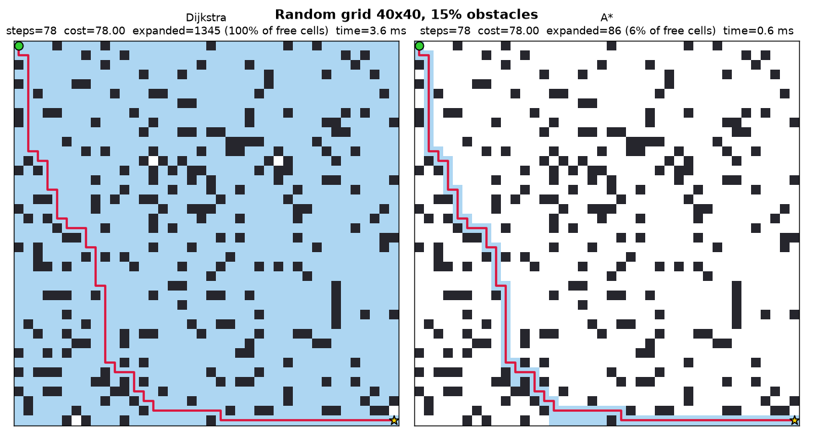
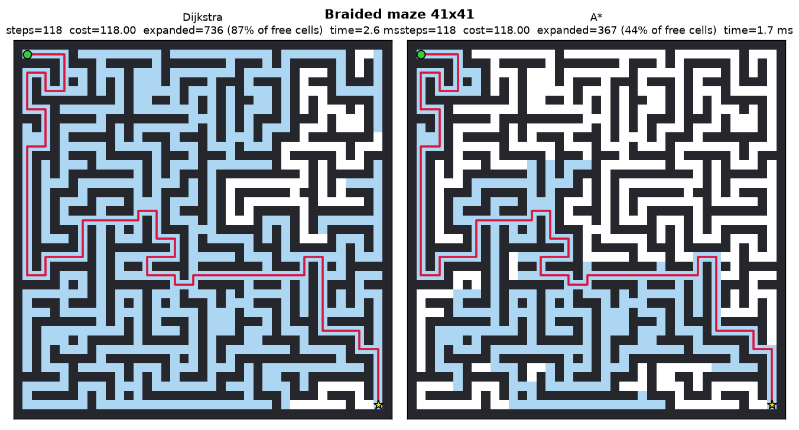
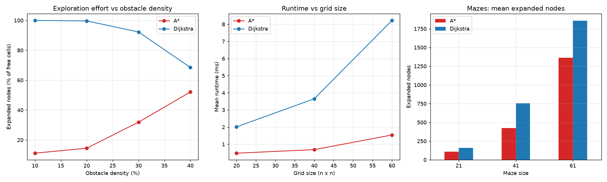

# Heuristic Graph Pathfinding Agent Search Engine

An optimization search framework in which a virtual agent finds the shortest route through grid mazes. **A\* Search** and **Dijkstra's algorithm** are implemented from scratch and compared on 300 test runs.

> Task 3 of an AI internship. Author: **Fiza Asghar**

## Key results

Mean over the 100 solved grids (grids with no possible path are excluded):

| Metric | Dijkstra | A* | A* vs Dijkstra |
|---|---|---|---|
| Expanded nodes | 1259.7 | 334.4 | 73.5% fewer |
| Expanded-node density | 94.9% | 29.4% | 65.5 points lower |
| Runtime | 3.71 ms | 1.11 ms | about 3.3x faster |
| Peak frontier size (memory) | 31.9 | 97.9 | about 3x more |
| Path cost | optimal | optimal | identical |

Both algorithms always returned a path of the same, optimal cost (checked by an assertion in the code on every run), but A* explored far fewer cells because its heuristic steers it toward the goal. The price is a larger open list (more memory).







An animated replay of the search order in a maze: [`search_animation_maze.gif`](results/figures/search_animation_maze.gif).

## How it works

- **Environment:** 2D grid, cells are free (0) or obstacles (1). Movement is 4-directional with cost 1. An optional 8-directional mode (`--diagonal`) uses diagonal cost of sqrt(2) and forbids cutting wall corners.
- **Dijkstra:** always expands the cell with the lowest cost so far, g(n).
- **A\*:** expands the cell with the lowest f(n) = g(n) + h(n), using the Manhattan distance (octile for diagonal moves) as an admissible heuristic, so the path stays optimal.
- **Implementation:** one search function, with Dijkstra as A* with h = 0; binary-heap priority queue (`heapq`) with lazy deletion of stale entries.

## Experiments

- **Random grids:** 3 sizes (20, 40, 60) x 4 obstacle densities (10%, 20%, 30%, 40%) x 10 seeds = 120 grids.
- **Mazes:** 3 sizes (21, 41, 61) x 10 seeds = 30 braided mazes (recursive backtracker with about 8% of inner walls removed so that several routes exist).
- **Metrics:** path steps and cost, expanded nodes, expanded-node density (share of free cells explored), peak frontier size, runtime.
- **Visualization logs:** side-by-side PNG figures, a summary chart, an animated GIF, JSON logs (grid, path, expansion order, metrics) and CSV tables.

## Project structure

```
task3-pathfinding-agent/
├── README.md
├── requirements.txt
├── pathfinding_agent.py        # all code: grids, A*, Dijkstra, experiments, plots, logs
├── results/
│   ├── experiments.csv         # every run
│   ├── summary.csv             # averages per setting
│   ├── figures/                # PNG figures and the GIF
│   └── logs/                   # JSON logs of the demonstration runs
└── report/
    └── Task3_Report.pdf
```

## How to run

```bash
pip install -r requirements.txt
python pathfinding_agent.py                 # 4-direction movement
python pathfinding_agent.py --diagonal      # 8-direction movement
python pathfinding_agent.py --out results --seeds 10
```

Runs in roughly 10 to 30 seconds and writes everything to the `results/` folder.

## Limitations

- The priority queue uses Python's built-in `heapq`; the search algorithms themselves are written from scratch.
- Only one heuristic was tested; weighted A*, bidirectional search and Q-Learning were not explored.
- At high obstacle densities few random grids are solvable (14 of 30 at 30%, only 1 of 30 at 40%), so results there are weak. 4-direction routes across large random grids become unlikely near 40% obstacles.
- Runtimes depend on the machine and are noisy for such small grids; the expanded-node counts are deterministic and are the more reliable comparison.

The full write-up is in [`report/Task3_Report.pdf`](report/Task3_Report.pdf).
