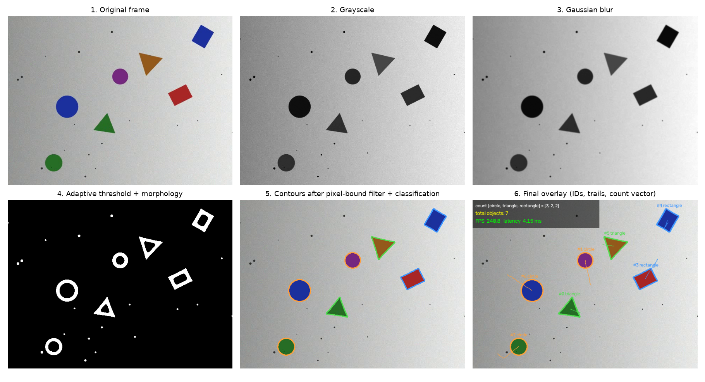
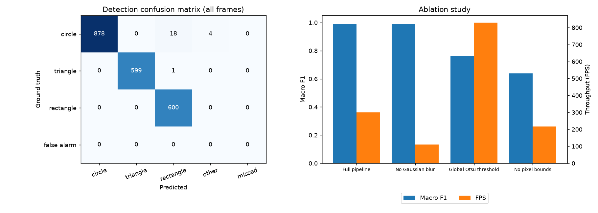
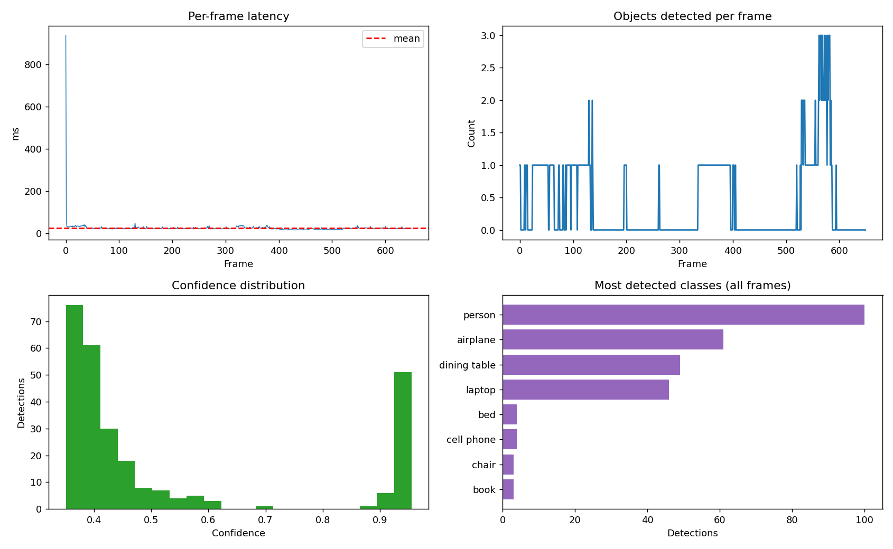

# Computer Vision Object Detector & Frame-by-Frame Segmenter Pipeline

Two real-time pipelines that extract, classify and track objects in video, with a live per-class **count vector** overlay and **frame-by-frame inference metrics**:

- **Pipeline A (classical OpenCV):** Gaussian filter, adaptive threshold, pixel-bound contour filtering, shape classification and centroid tracking.
- **Pipeline B (YOLO):** pre-trained YOLOv8n with ByteTrack tracking, run on Google Colab.

> Task 4 of an AI internship. Author: **Fiza Asghar**. The full 6-page performance whitepaper is in [`report/Task4_Whitepaper.pdf`](report/Task4_Whitepaper.pdf).

## Key results

**Pipeline A**, synthetic video with known ground truth (300 frames, 640x480, 7 moving shapes, uneven lighting, noise):

| Metric | Result |
|---|---|
| Macro F1 (circle / triangle / rectangle) | **0.990** |
| Exact per-class count vector correct | 92.3% of frames |
| Identity switches in tracking | 0 (7 tracks for 7 objects) |
| Latency per frame (CPU) | mean 4.04 ms, median 3.77 ms, p95 5.71 ms |
| Processing speed | about 248 FPS (90 FPS end to end including drawing and video writing) |

Ablation study (what happens when one component is removed):

| Variant | Macro F1 | Latency (ms) |
|---|---|---|
| Full pipeline | 0.990 | 3.34 |
| No Gaussian blur | 0.990 | 8.97 (2.7x slower) |
| Global Otsu threshold instead of adaptive | 0.763 | 1.21 |
| No pixel bounds (area filter) | 0.639 (precision 0.27) | 4.60 |

**Pipeline B**, YOLOv8n on a 650-frame room video (1280x720, Tesla T4 GPU):

| Metric | Result |
|---|---|
| Latency per frame (excluding the first warm-up frame) | mean 24.8 ms, median 23.8 ms, p95 34.9 ms |
| Speed | about 40 FPS |
| Frames with at least one detection | 35% (421 of 650 frames had none) |
| Mean confidence | 0.53 |

YOLO recognises only the 80 COCO classes, so many household items (wall frames, air conditioner, charger) were missed or mislabelled, and a ceiling fan was labelled "airplane" with 0.94 confidence. High confidence is therefore not proof of a correct label. See the whitepaper for the photo-by-photo error analysis.







## How Pipeline A works

1. Grayscale, then a 5x5 **Gaussian blur** to suppress noise.
2. **Adaptive threshold** (Gaussian-weighted local mean, 41 px neighbourhood) plus a small morphological close, so uneven lighting does not break the segmentation.
3. External contours, kept only if their **area is within pixel bounds** (250 to 20,000 px), which removes speckle noise and background blobs.
4. **Shape classification** by circularity and polygon approximation (circle, triangle, rectangle, other).
5. **Centroid tracker** gives every contour a persistent ID and a motion trail.
6. **Overlay:** contours, IDs, count vector `[circle, triangle, rectangle]`, total objects, FPS and latency.

## Project structure

```
task4-cv-pipeline/
├── README.md
├── requirements.txt
├── cv_pipeline.py                  # Pipeline A: video generation, pipeline, tracker, metrics, ablation, figures
├── notebooks/
│   └── task4_yolo_colab.ipynb      # Pipeline B (run on Google Colab with a T4 GPU)
├── results/
│   ├── partA_opencv/               # figures, sample frame, frame_metrics.csv, summary.json, ablation.csv
│   └── partB_yolo/                 # figures, sample frames, yolo_summary.json, yolo_frame_metrics.csv
└── report/
    └── Task4_Whitepaper.pdf
```

## How to run

**Pipeline A (local):**

```bash
pip install -r requirements.txt
python cv_pipeline.py                         # synthetic video with ground truth and full evaluation
python cv_pipeline.py --source my_video.mp4   # your own video (metrics without ground truth)
python cv_pipeline.py --source 0 --show       # live webcam, press q to quit
```

It writes an annotated video, per-frame metrics (CSV), a summary (JSON), the ablation table and figures to `cv_results/`.

**Pipeline B (Google Colab):** open `notebooks/task4_yolo_colab.ipynb` in Colab, select `Runtime > Change runtime type > T4 GPU`, run the cells from top to bottom and upload your own short video when asked.

## Limitations

- The synthetic video is clean (plain background, high contrast, little occlusion), so the near-perfect score of Pipeline A is optimistic for real scenes.
- The room video used for Pipeline B was built from ten still photos (a slideshow with slow zoom), not a real camera recording, and it is not included in this repository. It has no annotated boxes, so YOLO accuracy was assessed manually and mAP was not computed.
- Speeds of the two pipelines were measured on different hardware (CPU vs GPU) and different videos, so they are not a like-for-like race.
- Single runs on one machine; only YOLOv8n with a fixed 0.35 confidence threshold was tested.

## Future work

Annotate a few real video frames to compute mAP, compare larger YOLO models and fine-tune on household classes, test real moving-camera footage, and add a Kalman-filter tracker.
